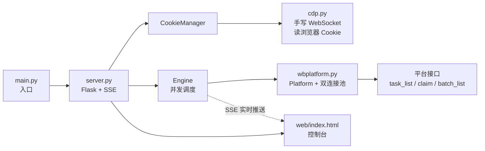

# WorkBench 自动领取工具

给数据标注团队做的**批次数据自动领取工具**。

平台按批次下发标注任务，数量有限，谁先点「领取批次」谁拿到数据。原来 20 多个人手动刷新页面、逐个任务点，一次点击 500–3000ms，一个人同时只能盯一个任务。

现在 30 个任务常驻轮询，发现余量增加就立即连击，领满自动切下一个。

- **使用规模**：团队 20+ 人
- **结果**：领取速度从 1–3 次/秒 提升到 **20–27 次/秒**；人均日领取量翻倍，不用人工盯守
- **技术栈**：Python（纯标准库）、Flask、CDP、SSE、PyInstaller
- **交付形态**：单个 `.exe`（约 9MB），双击即用，不需要装 Python

---

## 背景：为什么需要它

标注平台的任务按**批次**下发，数量有限，谁先点「领取批次」谁拿到数据，晚几秒就被别人抢走。团队每天的工作是：

1. 打开任务列表，翻页
2. 逐个点开任务，看还有没有余量
3. 有就点「领取批次」
4. 领到上限，换下一个任务，重复

全程手动。一次点击 500–3000ms，一个人同一时间只能盯一个任务。数据一放出来，所有人一起刷，抢到多少全看手速。

## 三次架构跃迁

这个工具的提速全部来自**架构**，不是调参数，也不是换语言。

| 版本 | 架构 | 领取速度 |
|---|---|---|
| v1.0 | 用 CDP 操控浏览器：找按钮 → 点击 → 等 DOM 渲染 | 1–3 次/秒 |
| v1.3 | 同上，但 CDP 请求复用 TCP 连接 | 同上（修掉慢速电脑的 2 秒延迟） |
| **v2.2** | **直接调「领取批次」按钮背后的同一个 HTTP 接口** | **20–27 次/秒** |

关键认知：**UI 是给人的，程序不需要 UI。**

浏览器弹窗、渲染表格、CDP 往返、DOM 查询，对程序来说全是开销。点「领取批次」按钮的背后，就是一个 `POST /api/ads-works/BatchWorkServiceI/workerFetch`。直接打这个接口，单次往返 60–150ms。

> 同一时期，同事把同类工具用 Node.js 重写，以为快是语言的原因。实际快在他把「操作 UI」换成了「直接调接口」。**换语言解决不了架构问题。**

## 架构

模块职责：

| 文件 | 职责 |
|---|---|
| `cdp.py` | 零依赖手写 WebSocket 客户端，连浏览器 DevTools 端口——**只用来读 Cookie** |
| `wbplatform.py` | 平台接口客户端：纯标准库 `http.client`，双 keep-alive 连接池 |
| `engine.py` | 调度核心：任务表、并发领取、burst 加速、账号锁、统计 |
| `server.py` | Flask 服务、SSE 推送、配置读写、单实例检测、端口自增 |
| `web/index.html` | 控制台：开关、实时日志、统计、配置 |

## 四个关键决策

### 1. 不操作 DOM，直接调接口

旧方案用 CDP 控制浏览器：打开任务、点击、等表格渲染、读行数判断成功。每次操作要经过「HTTP → CDP Proxy → WebSocket → 浏览器 JS 执行 → 渲染 → 回传」，一次领取 500–3000ms。

新方案：打开浏览器 DevTools，找到用户已经登录的那个页面，**只做一件事——读 Cookie**。拿到 Cookie 之后，所有操作都变成普通 HTTP 请求，和浏览器自己发的请求一模一样。

### 2. 双连接池：抢包洪峰不能堵住列表轮询

抢包和查列表是两种流量。抢包是脉冲式的（任务余量一出现，30 个任务同时开抢），查列表是周期性的（每 350ms 刷新一次任务余量）。

用一个池子，抢包洪峰会把连接全占满，列表轮询排队——结果就是「看不见新任务，抢也抢不到」。

拆成两个池：

- `claim_pool`：`concurrency + 8` 条连接，专给领取
- `list_pool`：固定 6 条，专给查列表和查账号

连接池用 `queue.LifoQueue` 存空闲连接 + `threading.Semaphore` 限同时借出数。既不会每请求三次握手，也不会把平台连接打爆。

### 3. 30 个任务常驻 + burst 上升沿加速

不是所有任务都用同一频率刷。平台的任务列表里有个字段 `waitingWorkBatchCount`（还有几批待领取）。

- 平时：每个任务按 `poll_ms`（350ms）轮询一次
- **余量从 0 变成 N**（上升沿）：这个任务立刻开 `burst` 路并发连击，一把抢完
- 抢完余量归零，回到慢速轮询

日志里会打 `⚡ 任务 xxx 出现 N 批待领取 → 立即连击`。

这样既不会无脑高频请求（省资源、降风控），又能在数据放出来的瞬间集中火力。

### 4. 账号锁：每 30 秒校验一次

工具是给团队用的，同一台电脑可能换账号登录。如果账号被切成管理员或别的角色，脚本还在用旧 Cookie 领数据，轻则 401，重则领错工序。

所以每 30 秒调一次 `getCurrentInformation`，比对角色名。角色不对就停下、报警、等人工确认。

## 踩过的坑（部分）

| # | 现象 | 根因 | 修法 |
|---|---|---|---|
| 1 | exe 双击闪退 | PyInstaller 漏收 `ffi.dll`（在 anaconda `Library\bin`，不在默认搜索路径） | spec 里显式加 `binaries` |
| 2 | 启动卡十几秒才出控制台 | 继承 `HTTPServer` 时 `socket.getfqdn()` 反向解析主机名 | 重写 `server_bind`，跳过反向解析 |
| 3 | 第一次读 Cookie 要等 10 秒 | 失败重试间隔太长 | 改 3 秒 + 快速重试，启动到可用约 4 秒 |
| 4 | 反复弹「允许远程调试」授权 | 任何错误都重连 CDP，把连接层错误和业务错误混在一起 | 只有连接层错误才重连 |
| 5 | 点了「下一批」按钮卡死 | 切换按钮抢 `exec_lock`，被连点循环持有 → 死锁 | 切换只设标志位，不抢锁 |
| 6 | 脚本一直点第一页第一个任务 | 用了全局按钮序号定位 | 按任务 ID 找表格行，再在行内找按钮 |
| 7 | 翻页点了没反应 | 没校验，假设一定成功 | 轮询检查 `.ant-pagination-item-active` 文本 |
| 8 | antd 弹窗关闭后 DOM 还在 | `querySelectorAll('.ant-modal')` 拿到隐藏的旧弹窗 | 过滤 `offsetParent !== null` |
| 9 | 打了 334MB 的包，双击卡死 | 把整个 anaconda 打进去了 | 用 spec 精简，只打必要依赖 |
| 10 | 并发开到 60 反而更慢 | 平台服务端排队，单次 3 秒以上 | 测拐点：`per_task` 1–2、`concurrency` 30–60 |

完整复盘见 [`docs/troubleshooting.md`](docs/troubleshooting.md)。

## 版本演进

| 版本 | 关键变化 |
|---|---|
| v1.0 | 打通主流程：遍历任务、翻页、领取、循环 |
| v1.1–1.3 | 修复慢速电脑 2 秒延迟（keep-alive 复用） |
| v1.4 | 返修弹窗误判；成功判定改为批次行数差值 |
| v1.5–1.12 | 连点模式、高优过滤、手动切换、死锁修复；连点搬到浏览器端 |
| v1.24 | PyInstaller 漏 DLL 导致闪退的根治 |
| v1.25 | 不再自动新开页面；自动筛「验收」工序；双保险不领标注包 |
| **v2.2** | **架构重写：DOM 点击 → 接口直连；1–3 次/秒 → 20–27 次/秒** |

## 这个项目里我负责什么

- **需求**：跟主管和同事确认「哪些任务要过滤、领到多少算满、失败了怎么提示」
- **方向**：从「操作 UI」到「直接调接口」的路线是我和 AI 一起定的；双连接池、burst 上升沿这些具体实现由 AI 完成，我负责验收和压测
- **实现**：AI 编程工具辅助写代码（Claude Code / Qoder），我负责拆需求、验证行为、定位问题
- **排障**：上面 10 个坑里的大部分是我在同事电脑上复现、抓包、定位出来的
- **推广**：写启动说明、在团队群里答疑、收集反馈迭代
- **交付**：PyInstaller 打包，分享版/最终版分离（key 不进分享包）

> 说明：这是一个**真实业务工具**，涉及内部平台，所以本仓库只放复盘文档，不放源码、平台地址和数据。源码可以面试时演示。
